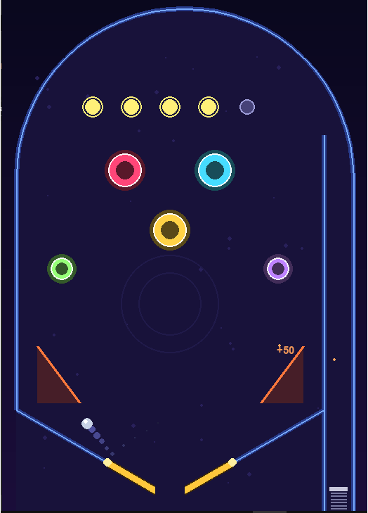

  <h1>⚡ NEON PINBALL ARCADE</h1>
  
<em>Simulação Física de Alta Fidelidade • Síntese de Áudio Procedural • Gráficos Vetoriais Puros</em>

  

    
    
    
    
    
  

   

  

  
  

  

  

    <b>Uma mesa completa de Pinball retro-arcade com física de corpos rígidos vetorial implementada do zero em Python nativo, sem motores externos como Box2D ou Pymunk, e sem recurso a ficheiros de áudio ou sprites externos.</b>
  

  

    <a href="#-controlos">🎮 Controlos</a> •
    <a href="#-arquitetura-e-engenharia-de-física">🔬 Engenharia &amp; Físicas</a> •
    <a href="#-regras-e-pontuação">🕹️ Regras da Mesa</a> •
    <a href="#-como-executar">🚀 Instalação</a>
  

  

<h2>🌟 Visão Geral do Projeto</h2>

  O <strong>Neon Pinball</strong> recria a dinâmica real de uma máquina eletromecânica de flippers dos anos 80/90. O diferencial deste projeto reside na sua <strong>independência de assets externos</strong>: todos os elementos visuais, curvaturas de rampa, colisores, partículas incandescentes e sons de impacto são calculados e gerados proceduralmente por código matemático em tempo de execução.

<h2 id="-arquitetura-e-engenharia-de-física">🔬 Arquitetura e Engenharia de Física</h2>

<h3>1. ⚙️ Pipeline Física com Sub-Stepping (Anti-Tunneling)</h3>

  Bolas de pinball atingem velocidades de pico elevadas (<code>MAX_SPEED = 27 px/frame</code>). Em motores físicos a 60 FPS, isso causaria o efeito de <em>tunneling</em> (a bola atravessar paredes ou flippers entre fotogramas consecutivos).

<ul>
  <li><strong>Solução:</strong> O ciclo principal divide cada fotograma em <strong>6 sub-passos temporais discretos</strong> (<code>SUBSTEPS = 6</code>), elevando a taxa de amostragem interna para <strong>360 Hz</strong>.</li>
  <li>A integração das equações de Euler modificadas assegura trajetórias estáveis e colisões contínuas mesmo durante impactos elásticos de alta intensidade.</li>
</ul>

<h3>2. 🕹️ Cinemática Rotacional dos Flippers</h3>

  Os batentes (flippers) não atuam apenas como defletores geométricos estáticos:

<ul>
  <li>O sistema calcula a <strong>velocidade angular instantânea</strong> (<code>ω = Δθ / Δt</code>) da ponta e do corpo do flipper.</li>
  <li>No momento do contacto, a velocidade superficial tangencial é calculada vetorialmente: <code>v_superfície = (-ω · r_y, ω · r_x)</code>.</li>
  <li>Essa velocidade é transferida diretamente como momento linear adicional para a bola, permitindo tacadas calculadas, amortecimentos suaves e disparos com base no tempo de acionamento.</li>
</ul>

<h3>3. 🔊 Síntese Procedural de Áudio (DSP por Software)</h3>

  Nenhum ficheiro <code>.wav</code> ou <code>.mp3</code> é necessário no repositório. O jogo sintetiza som diretamente na memória RAM através do módulo nativo <code>array</code> do Python:

<ul>
  <li><strong>Bumpers &amp; Plunger:</strong> Modulação de frequência por chirp senoidal combinada com decaimento exponencial de envelope.</li>
  <li><strong>Flippers &amp; Slingshots:</strong> Injeção controlada de ruído pseudo-aleatório (ruído branco filtrado) misturado com frequências graves para simular o solenoide mecânico.</li>
  <li><strong>Alvos e Bónus:</strong> Ondas quadradas harmónicas sintetizadas por software para timbres característicos de chips de som vintage.</li>
</ul>

<h3>4. 🧮 Geometria Analítica e Deteção Contínua</h3>
<ul>
  <li><strong>Projeção Escalar em Segmentos:</strong> Cálculo parametrizado <code>t ∈ [0, 1]</code> para deteção precisa em paredes lineares e guias angulares.</li>
  <li><strong>Colisão Elástica Esfera-contra-Esfera (Multibola):</strong> Resolução de sobreposição geométrica com conservação de momento linear nos eixos normais de impacto.</li>
</ul>

<h2 id="-controlos">🎮 Controlos</h2>

<table>
  <thead>
    <tr>
      <th align="left">Comando</th>
      <th align="left">Tecla Teclado</th>
      <th align="left">Efeito Mecânico</th>
    </tr>
  </thead>
  <tbody>
    <tr>
      <td><strong>Flipper Esquerdo</strong></td>
      <td><kbd>Seta Esquerda</kbd> ou <kbd>Z</kbd></td>
      <td>Aciona o flipper esquerdo com rotação acelerada</td>
    </tr>
    <tr>
      <td><strong>Flipper Direito</strong></td>
      <td><kbd>Seta Direita</kbd> ou <kbd>M</kbd></td>
      <td>Aciona o flipper direito com rotação acelerada</td>
    </tr>
    <tr>
      <td><strong>Mola de Lançamento</strong></td>
      <td><kbd>Barra de Espaço</kbd></td>
      <td><strong>Segure</strong> para tensionar a mola; <strong>solte</strong> para disparar</td>
    </tr>
    <tr>
      <td><strong>Sacudir Mesa (Nudge)</strong></td>
      <td><kbd>Seta para Cima</kbd> ou <kbd>X</kbd></td>
      <td>Aplica aceleração caótica (máximo de 3 vezes por bola)</td>
    </tr>
    <tr>
      <td><strong>Reiniciar Partida</strong></td>
      <td><kbd>R</kbd></td>
      <td>Reinicia a mesa após o ecrã de Fim de Jogo</td>
    </tr>
    <tr>
      <td><strong>Sair</strong></td>
      <td><kbd>ESC</kbd></td>
      <td>Encerra a aplicação</td>
    </tr>
  </tbody>
</table>

<h2 id="-regras-e-pontuação">🕹️ Regras e Pontuação</h2>

<table>
  <thead>
    <tr>
      <th align="left">Elemento</th>
      <th align="left">Pontuação</th>
      <th align="left">Efeito Especial</th>
    </tr>
  </thead>
  <tbody>
    <tr>
      <td><strong>Bumpers Centrais</strong></td>
      <td>100 × Multiplicador</td>
      <td>Impulso elástico radial +4.5</td>
    </tr>
    <tr>
      <td><strong>Kickers / Slingshots</strong></td>
      <td>50 × Multiplicador</td>
      <td>Repulsão angular rápida</td>
    </tr>
    <tr>
      <td><strong>Alvos Superiores (5x)</strong></td>
      <td>500 × Multiplicador</td>
      <td>Ilumina indicador neon</td>
    </tr>
    <tr>
      <td><strong>Combo Todos os 5 Alvos</strong></td>
      <td>+2.500 Pontos</td>
      <td>Aumenta Multiplicador e ativa MULTIBOLA</td>
    </tr>
    <tr>
      <td><strong>Bola Extra</strong></td>
      <td>Atingir 20.000 pts</td>
      <td>+1 Vida adicional</td>
    </tr>
  </tbody>
</table>

<blockquote>
  
<strong>🔥 Multibola:</strong> Ao acender os 5 alvos de topo, o multiplicador de pontuação aumenta (até <strong>x5</strong>) e uma nova bola entra imediatamente em jogo pelo topo do ecrã!

</blockquote>

<h2 id="-como-executar">🚀 Como Executar</h2>

<h3>Pré-requisitos</h3>
<ul>
  <li>Python 3.10 ou superior instalado.</li>
</ul>

<h3>Passo a Passo</h3>
<pre><code># 1. Clonar o repositório
git clone https://github.com/Edinaldo-long/pinball.git
cd pinball

# 2. Instalar a dependência
pip install pygame

# 3. Executar a mesa
python pinball.py</code></pre>

